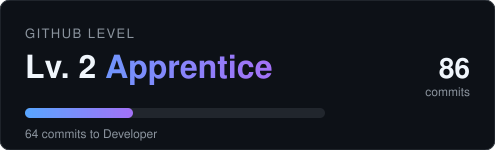

# Hey, I'm Diego 👋

Software Engineering student at **FIAP**, focused on **back-end development with Java**. I'm studying a lot, building real projects along the way, and also taking on freelance front-end work.

- 🎓 Software Engineering @ FIAP
- ☕ Learning **Java + Spring Boot** for web applications and REST APIs
- 🌧️ Building **ALERA**, a rain-risk alert system for Juiz de Fora (MG)
- 💼 Freelance: built the landing page for a parking business in Rio de Janeiro
- 🌐 Portfolio: [diego-olalla.vercel.app](https://diego-olalla.vercel.app/)
- 📬 Reach me on [LinkedIn](https://www.linkedin.com/in/diego-alejandro-8b21173b6)
- 🔎 **Open to internship opportunities**

## 🛠️ Tech Stack

**Back-end**

**Front-end**

**Tools**

## 🚀 Projects

| Project | What it is | Stack |
|---|---|---|
| [ALERA](https://github.com/Diarooll/ALERA) · [site](https://diarooll.github.io/ALERA/) | Rain-risk alerts with your street's name, sent to your WhatsApp. It crosses the weather forecast with the 142 mapped risk areas of Juiz de Fora. **Growing project.** | HTML · CSS · JS |
| [Sito's Estacionamento](https://github.com/Diarooll/Sito-s-estacionamento) | Freelance landing page for a parking business in Méier (RJ), built without libraries | HTML · CSS · JS |
| [Portfolio](https://github.com/Diarooll/portfolioProGit) | My personal portfolio site | HTML · CSS · JS |

## 📊 GitHub

  

---

Always open to feedback, study partners and internship opportunities. Feel free to reach out!
